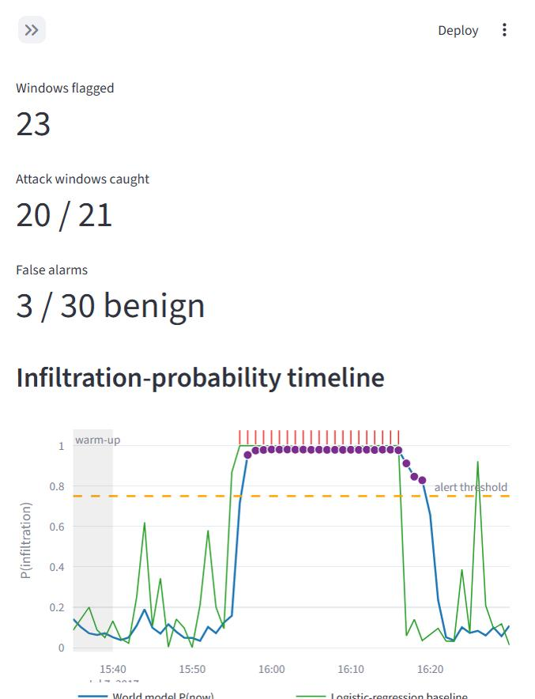
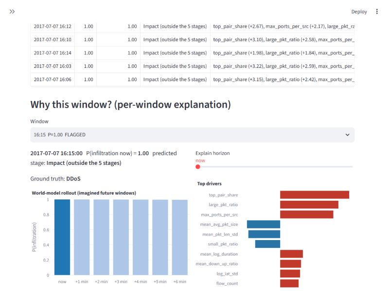

# Network Attack Early Warning: a world-model study on CIC-IDS2017

[](https://github.com/ydhitler1-arch/network-attack-world-model/actions/workflows/ci.yml)

An end-to-end, explainable network-intrusion pipeline, and an honest test of a question: **can a model that learns how network state evolves warn about an infiltration earlier or better than a simple classifier?** On CIC-IDS2017 the answer I found is **no**, and this repository shows how I got to that answer and why it is trustworthy.

> **Headline.** A learned LSTM "world model" does **not** beat plain logistic regression at detecting attacks (PR-AUC 0.30 vs 0.45; the gap is not statistically significant with 41 attack episodes), shows no reliable skill at predicting attacks minutes ahead, and misses most attack types it was not trained on. The full pipeline, explanations and offline demo work and are validated. The value of the project is the pipeline and the evaluation method.



*The offline demo on a slice of real CIC-IDS2017 traffic: world-model probability (blue), logistic-regression baseline (green), true attack minutes (red ticks), alert threshold (dashed), predicted ATT&CK stage on flagged windows (purple). The sample is in-sample for the shipped model, so it flatters it; see the benchmark below for out-of-sample numbers.*

## What it does

1. **Traffic to state.** Flow CSVs (or PCAPs, via Scapy) become a 43-feature state vector for every 60 seconds: flow statistics, TCP flag shares, inter-arrival times, scan signatures such as ports touched per source, and packet-size proxies.
2. **A learned model of how the state evolves.** An LSTM (100,702 parameters) reads the last 6 windows and predicts a Gaussian over the next state. A 6-step rollout feeds its own predictions back in and reads an infiltration probability and a MITRE ATT&CK stage at every step.
3. **Explanations for every output.** SHAP values (expected-gradients estimator, checked against the `shap` library) show which features and which minute drove a score. A counterfactual removes a host's traffic and re-scores, to show which machines drive an alert.
4. **An offline demo.** A Streamlit app takes a CSV or PCAP and shows the timeline, flagged windows, drivers, stage markers and flagged hosts and flows. No network access needed.



*Per-window explanation for a DDoS minute: red bars push the score towards "attack", blue away from it.*

## Results

Blocked 5-fold cross-validation with a purge gap, scaler refit per fold, thresholds calibrated on a validation fold for a 2% false-alarm target, 3 seeds, block-bootstrap confidence intervals. Detecting the current window (2,095 test samples, 11% attack):

| model | PR-AUC [95% CI] | precision | recall | F1 | false-alarm rate |
|---|---|---|---|---|---|
| Logistic regression | **0.451** [0.23, 0.67] | 0.67 | 0.32 | **0.43** | 0.020 |
| LSTM classifier | 0.350 [0.16, 0.59] | 0.32 | 0.30 | 0.31 | 0.078 |
| World model | 0.299 [0.14, 0.53] | 0.34 | 0.27 | 0.30 | 0.065 |

- **No established forecasting skill.** Predicting 3 minutes ahead, every model scores PR-AUC 0.18 to 0.27 against a base rate of 0.11; the world model is highest, but 11 of 12 paired comparisons are not significant. Attacks in this dataset start abruptly, with no ramp-up to learn from.
- **Weak on unseen attacks.** Leave-one-attack-type-out mean recall: logistic regression 0.36, LSTM 0.25, world model 0.21. Bot, DoS GoldenEye and DoS Hulk are missed by every model.
- **Learned dynamics barely beat a straight line.** A per-feature linear AR(1) predictor ties the LSTM at one step ahead and beats it further out.
- **Explanations hold up.** Deleting the top 3 SHAP features lowers the score by 2.14 logits against about 0 for random features.

The world model's training objective was revised after a first run found it significantly worse than logistic regression (PR-AUC 0.22); the first-run results are kept in `models/v1_original_objective/` and the reasoning is in [docs/OVERFITTING_TEST.md](docs/OVERFITTING_TEST.md).

Full numbers and caveats: [docs/BENCHMARK.md](docs/BENCHMARK.md), [docs/WORLD_MODEL.md](docs/WORLD_MODEL.md), [docs/EXPLAINABILITY.md](docs/EXPLAINABILITY.md). A narrative write-up: [docs/BLOG.md](docs/BLOG.md).

## What I learned

- **Evaluation design matters more than model choice.** Overlapping windows leak between train and test unless you purge around fold boundaries; thresholds calibrated on one day drift on the next (realised false-alarm rates 2% to 8% against a 2% target); a leave-one-attack-type-out test exposes weaknesses that average metrics hide.
- **Compare against the dumbest baseline first.** A logistic regression and a linear AR(1) predictor beat the neural models. Without them the LSTM would have looked fine.
- **Test your explanation for a failure, don't assume it.** I guessed the world model lost because it overfit. A capacity sweep showed that was mostly wrong; a follow-up with a prediction written down in advance pointed at the training objective instead, which recovers much of the gap (better in all 5 seeds; [docs/OVERFITTING_TEST.md](docs/OVERFITTING_TEST.md)).
- **Explanations need validation too.** I checked SHAP against the library implementation, measured the completeness error (9.5%), and ran a deletion test instead of trusting the plots.
- **Say what the data cannot support.** CIC-IDS2017 has no exfiltration label, DoS attacks fit none of the five ATT&CK stages used, and a CSV cannot provide TTL or retransmission features. These limits are documented rather than hidden.

## Try it

Tested with Python 3.13.5 on Windows 11, CPU only.

```bash
python -m venv .venv
# Windows: .venv\Scripts\activate      Linux/macOS: source .venv/bin/activate
pip install -r requirements.txt
streamlit run dashboard/demo.py
```

The repository ships the trained weights and two samples in `data/sample/` (a 55-minute slice of real CIC-IDS2017 traffic and a synthetic PCAP). Pick a sample in the sidebar, or upload your own CSV (CICFlowMeter layout) or PCAP. Note that the CIC-IDS2017 sample is in-sample for the shipped model and the PCAP sample is synthetic, and the model does not flag the scan in it (it flags a later connection burst instead).

### Reproduce everything

1. Download CIC-IDS2017 from the Canadian Institute for Cybersecurity (https://www.unb.ca/cic/datasets/ids-2017.html) and put the eight flow CSVs that include `Flow ID`, IP addresses and timestamps (file names end in `.pcap_ISCX.csv`) in `data/raw/`. Do not use the "cleaned" Kaggle version (no timestamps or IPs).
2. Run, in order:

```bash
python -W ignore src/state.py data/raw 60        # flows -> 43-feature windows (a few minutes, several GB RAM)
python -W ignore src/wm_train.py                 # train/validate world model, sanity evaluation (~1 min)
python -W ignore src/wm_train.py --mode full     # demo weights trained on all days
python -W ignore src/benchmark.py --part cv --seeds 3     # blocked CV vs baselines (~1.5 min)
python -W ignore src/benchmark.py --part loto             # leave-one-attack-type-out (~6 min)
python -W ignore src/benchmark.py --part report           # metrics + bootstrap CIs
python -W ignore src/explain.py                  # SHAP table and validation (~4 min)
```

3. Tests (also run on every push by GitHub Actions):

```bash
python -W ignore tests/test_leakage.py     # no train/test leakage in the purged blocked CV and leave-one-attack-type-out splits
python -W ignore tests/test_phase1.py      # PCAP to state vector
python -W ignore tests/test_phase5.py      # demo pipeline on the samples
python -W ignore tests/test_demo_app.py    # Streamlit demo smoke test
```

Seeds are fixed (42) and training is deterministic on CPU: repeated runs gave identical metrics. Hyperparameters and the ATT&CK stage mapping are in [configs/world_model.json](configs/world_model.json).

## Repository layout

| path | contents |
|---|---|
| `src/data_loader.py`, `src/state.py` | CIC-IDS2017 loader, 43-feature state vector, scaler |
| `src/pcap_to_flows.py` | PCAP to flows with Scapy (adds TTL, fragmentation, retransmission columns) |
| `src/world_model.py`, `src/wm_train.py` | LSTM world model, rollout, training and sanity evaluation |
| `src/benchmark.py` | blocked CV with purge, leave-one-attack-type-out, bootstrap CIs |
| `src/explain.py`, `src/inference.py` | SHAP, counterfactual host analysis, demo pipeline |
| `dashboard/demo.py` | the offline Streamlit demo (`dashboard/app.py` is an older replay dashboard) |
| `configs/`, `models/`, `data/sample/` | config, trained weights and results, demo inputs |
| `tests/` | leakage, PCAP, demo-pipeline and demo smoke tests |
| `docs/` | architecture, features, world model, benchmark, explainability, blog write-up, early-detection study |
| `src/features.py`, `evaluate.py`, `detect_eval.py`, `train.py`, `model.py`, `sequence_builder.py`, `make_synthetic_data.py` | the earlier pipeline: forecasting at chance, reframed as early detection ([docs/EARLY_DETECTION_STUDY.md](docs/EARLY_DETECTION_STUDY.md)); the synthetic data has a planted ramp and is a methodology demo only |

## Limitations and next ideas

Only 41 attack episodes in 5 days of one lab network; minute-resolution timestamps; scripted attacks with no realistic reconnaissance phase; no exfiltration or multi-stage kill-chain labels; the demo model was trained on all days for 3 epochs. Not tried yet: a finer-resolution dataset with multi-stage attacks (CIC-IDS2018, CTU-13), stronger regularisation or a Transformer in place of the LSTM, host-level graph state, and capturing real PCAPs from a lab network to test the PCAP path on non-synthetic traffic.

## Background and licence

This began as an entry for SIH 2026 problem statement PS 26153 (AI-based network attack forecasting) and continues as a personal research and portfolio project; the hackathon material is kept in [docs/hackathon/](docs/hackathon/). Released under the [MIT licence](LICENSE).
