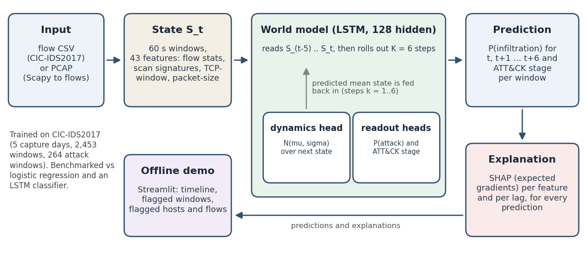

# Architecture: World-model early warning of network infiltration (SIH PS 26153)

**Status in one paragraph.** The system is a complete, reproducible, offline pipeline: traffic to state vector, learned next-state dynamics with a 6-step rollout, infiltration probability and ATT&CK stage, SHAP explanation for every prediction, and a Streamlit demo. Evaluated honestly on CIC-IDS2017, **the temporal world model does not beat a plain logistic-regression baseline** (after fixing its training objective it is statistically indistinguishable at detection, with a lower point estimate) and shows no reliable forecasting skill; the results sections state the numbers.

## 1. Input and state vector

Inputs are flow CSVs (CICFlowMeter layout) or PCAPs. A PCAP is converted to flows with Scapy (bidirectional 5-tuples, 120 s idle timeout), which also yields packet-level columns: TTL and its variance, TCP window, fragment flags, retransmissions. Flows are grouped into **60 s windows**; each window is one state S_t with 43 features, log1p-transformed and z-scored (scaler fit on benign training windows only):

- 13 base features: rates, unique destinations/ports, SYN ratio, source-IP entropy, byte asymmetry, concentration shares (top source, top port, top src-dst-port pair), mean log duration.
- 22 flow-level features: FIN/RST/PSH/ACK/URG flag shares, SYN-without-ACK share, TCP/UDP mix, packets and bytes per flow, IAT mean/std/max, backward/forward ratios, no-reply and single-packet shares, maximum ports and hosts contacted per source.
- 8 packet-level proxies available in a CSV: first-packet TCP window, per-flow average-packet-size distribution.

A CSV cannot supply TTL, fragmentation flags or retransmissions. The PCAP path extracts them (verified on a synthetic capture), but the trained model does not use them, because the training data cannot provide them.

## 2. World model

One LSTM cell (128 hidden units, 100,702 parameters). After consuming a state it outputs (a) a diagonal Gaussian over the **next state**, P(S_t+1 | S_<=t), as current state plus a learned delta; (b) an infiltration logit; (c) an ATT&CK stage over 7 classes. The model reads the last L = 6 windows, then performs a **K = 6 step rollout**: the predicted mean state is fed back as the next input, and the infiltration and stage heads are read at every step. The output is a probability series for the current window and the next six. Training uses a Gaussian NLL for the next state, unrolled through the same rollout, plus class-weighted BCE for infiltration and class-weighted cross-entropy for stage on the real history steps only (applying them to imagined future states hurt detection). Transitions come from the dataset's own timeline (consecutive windows within a capture day). Seeds, hyperparameters and the stage mapping are in `configs/world_model.json`.

**Stage mapping.** PortScan = Reconnaissance; FTP/SSH-Patator, web attacks, Heartbleed = Initial Access; Infiltration = Lateral Movement; Bot = Command and Control. **DoS/DDoS are Impact and fit none of the five stages**, so they get a sixth class. **No CIC-IDS2017 label is Exfiltration**, so that output has no training examples and cannot be learned.

## 3. Explainability

Every prediction (infiltration probability at each rollout step, and the stage) gets a SHAP attribution over the 43 features and the 6 lags, using the expected-gradients estimator (the one behind `shap.GradientExplainer`), implemented to differentiate through the rollout. Validation: r = 0.99 with the `shap` library; deleting the top-3/5/10 features lowers the logit by 2.14/2.81/4.11 against about 0 for random features; completeness residual 9.5% at 256 draws (approximate, not exact). The demo also explains which hosts drive an alert by removing a host's flows from the whole lookback and re-scoring.

## 4. Evaluation (CIC-IDS2017, 2,453 windows, 264 attack windows)

Blocked 5-fold CV (60-window blocks, 12-window purge, scaler refit per fold, thresholds calibrated on a validation fold for a 2% false-alarm target), 3 seeds, block-bootstrap CIs; plus leave-one-attack-type-out. Detecting the current window (k = 0):

| model | PR-AUC [95% CI] | precision | recall | F1 | FPR |
|---|---|---|---|---|---|
| Logistic regression | **0.451** [0.23, 0.67] | 0.67 | 0.32 | **0.43** | 0.020 |
| LSTM classifier | 0.350 [0.16, 0.59] | 0.32 | 0.30 | 0.31 | 0.078 |
| World model | 0.299 [0.14, 0.53] | 0.34 | 0.27 | 0.30 | 0.065 |

The world model's point estimate is below logistic regression's, but the paired difference (-0.14, CI [-0.35, +0.05]) is not significant, as is the gap to the LSTM classifier. (With its original objective it was significantly worse, PR-AUC 0.22; the change and the evidence for it are in `docs/OVERFITTING_TEST.md`.) Predicting 3 minutes ahead, all models reach only PR-AUC 0.18-0.27 (base rate 0.11); the world model is highest but 11 of 12 paired comparisons are not significant, consistent with the finding that attacks start abruptly with no precursor at 1-minute resolution. For unseen attack types the mean recall is 0.36 (logistic regression) versus 0.21 (world model); Bot, DoS GoldenEye and DoS Hulk are missed by every model. The learned dynamics tie a linear AR(1) predictor at one step and lose to it further ahead. **The requirement that the world model show a measurable improvement over logistic regression is not met on this data.**

## 5. Offline demo and reproducibility

`streamlit run dashboard/demo.py` accepts a CSV or PCAP and shows the probability timeline, ATT&CK stage annotations, flagged windows with SHAP drivers, and flagged hosts and flows. It needs no network access. Code, config, weights and tests are in the repository; all numbers above are produced by scripts in `src/` (`docs/BENCHMARK.md` has the commands).

## 6. Limitations

41 attack episodes in 5 capture days of one lab network; minute-resolution timestamps; the stage head cannot output Exfiltration and rarely identifies Recon or C2; the demo weights were trained on all days for 3 epochs, so the bundled CIC-IDS2017 sample is in-sample; thresholds drift across days. A finer-resolution dataset with multi-stage attacks (for example CIC-IDS2018 or CTU-13) is the next step.
